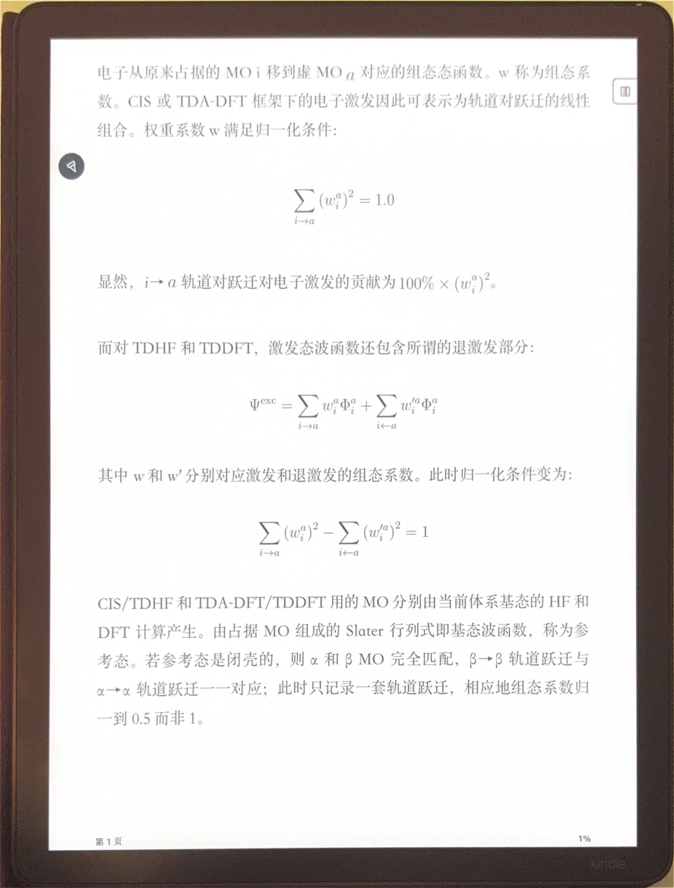
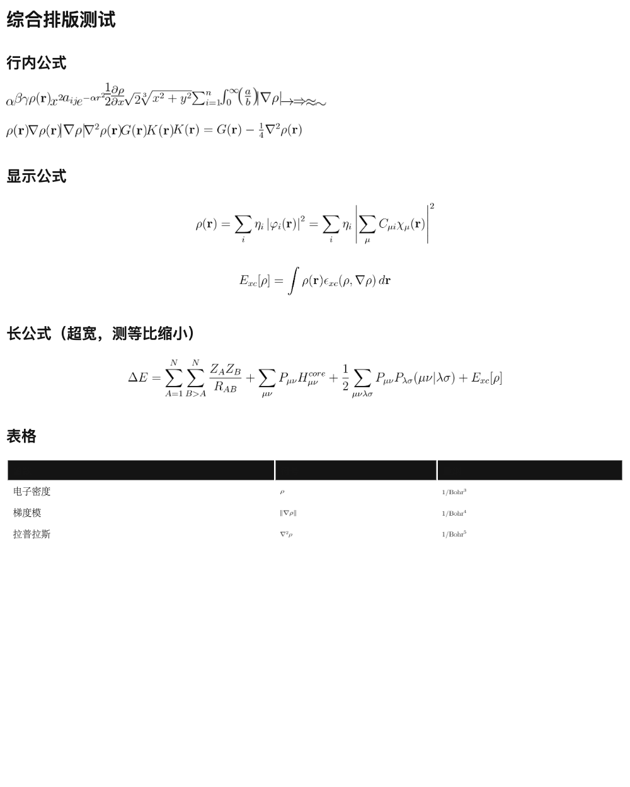

# inkline

把带公式的 Markdown 中文手册，变成 Kindle 上能看、能写的电子书。

## 效果





## 故事

起点是把 Multiwfn 官方手册（39MB PDF，全是量子化学公式）做成中文 Kindle 版，放到 Scribe 上边看边写。市面上没有一条路走得通，我们把每个坑都踩了一遍：

**第一坑：公式变空白。** EPUB 里内联 SVG 公式，KF8 直接丢弃，Kindle 上全是空框。解法：公式预渲染 300dpi PNG 外链。但透明底 PNG 在 Kindle 上渲成黑块——出厂前统一合成白底。

**第二坑：Calibre 丢图。** EPUB→AZW3 经 Calibre，29 张公式图进包但只有 1 张被引用，其余全空白；小文件连正文都丢。这是 Calibre 8 KF8 writer 的 bug，不是我们的文件问题。解法：换 Rust 开源实现 boko，直写 KFX，29/29 全保留。

**第三坑：公式独占行。** boko 把所有 `` 定为块级，行内公式 `文字[公式]文字` 被拆成三行。逆向 Send-to-Kindle 下发的官方 KFX，找到三处差异：image 要嵌进 text 的 content_list、加 `render: inline` 标记、style 写 `width/height/baseline_shift`。boko 代码里符号全有就是没用上——我们写了个 Ion 级后处理 `kfx_patch`，只改两个 entity 内容（不增删，加 entity 会导致 Kindle 拒开），行内不断行。

**第四坑：尺寸与基线。** Kindle 按 PNG 像素显示，无 CSS 缩放——300dpi 高清图显示成 5.7 倍大。按每张图反推 em 写回 style（36 进制资源名映射、字节级 PNG 匹配）；超宽公式去 height 等比缩；基线 `bs = -(h/2-0.25) + 0.2`，Scribe 真机三档盲测调定。

**第五坑：代码块挤成一行。** boko 吃掉 pre 内空白。源头改写：换行转显式 `<br/>`、缩进转 `&nbsp;`，Kindle 模式代码块去背景。

终点：USB 拷进 Scribe，行内公式齐平、显示公式居中、代码换行、手写批注——全有。

## 安装

```bash
pip install -r requirements.txt   # mistune pygments Pillow
cargo install boko                # EPUB → KFX（需 Rust）
```

## 用法

```bash
# EPUB（通用阅读器）
python3 inkline.py input.md -o book.epub --title "书名" --kindle

# KFX（Kindle 直传，行内公式不断行）
python3 inkline.py input.md --title "书名" --kfx book.kfx

# 整本手册
python3 build_kfx.py -o 手册.kfx   # 在 Multiwfn_office 下
```

整目录：`python3 inkline.py docs/ --title T --kfx book.kfx -r`

## 链路

```
md → EPUB（kindle 模式：公式 PNG 外链 + 白底 + 代码块 br/nbsp）
   → boko convert（EPUB → KFX 原生 Ion）
   → kfx_patch（行内修复，见下）
```

## kfx_patch 原理（逆向官方 KFX）

对照 Send-to-Kindle 下发的官方 KFX，boko 生成的差三处，patch 全补：

| | 官方 | boko 原 | patch 后 |
|---|---|---|---|
| 嵌套 | image 在 text 的 content_list 内 | 同级 sibling（块） | 内嵌 |
| 标记 | `render: inline` | 无 | 加 |
| 样式 | `width/height(em)+baseline_shift` | 空（yj.vertical_align Kindle 不认） | 按每图 em 重写 |

基线公式：`bs = -(h/2 - 0.25) + 0.2`（Scribe 真机调定，0.2 为经验偏移）。

只改 storyline/style entity 内容，不增删 entity（新增 entity 会导致 Kindle 拒开）。

## 结构

```
inkline_lib/
  pipeline.py    构建主流程
  htmlrender.py  公式/代码块 HTML（含 kindle 适配）
  mathrender.py  公式预渲染（SVG→PNG 300dpi）
  epub.py        EPUB 打包
  kfx_build.py   EPUB→KFX 一键（白底+boko+patch）
  kfx_patch.py   KFX 行内修复
  kfx_ion.py     最小 Ion 编解码
  kfx_symbols.py YJ 符号表（852）
```

## 手写

USB 侧载的 KFX 在 Scribe 上可手写（真机验证）。

## 局限

- 超宽行内公式（>30em）按 max-width 等比缩小，可能偏小。
